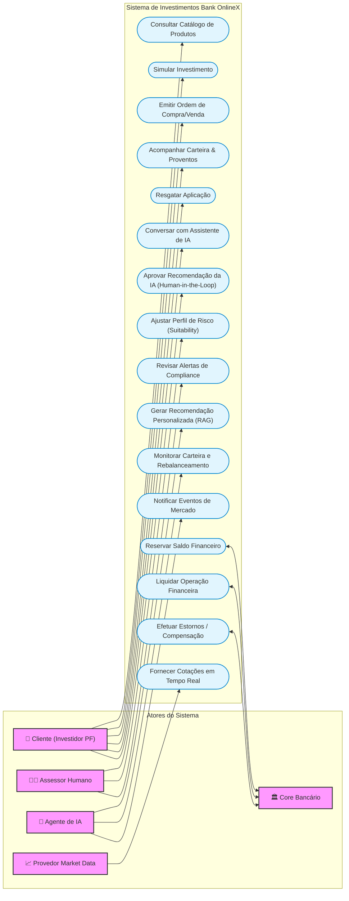
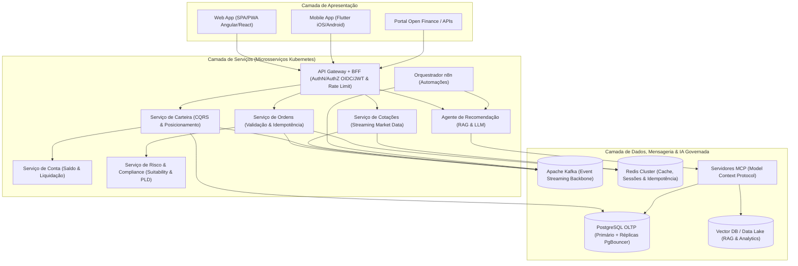
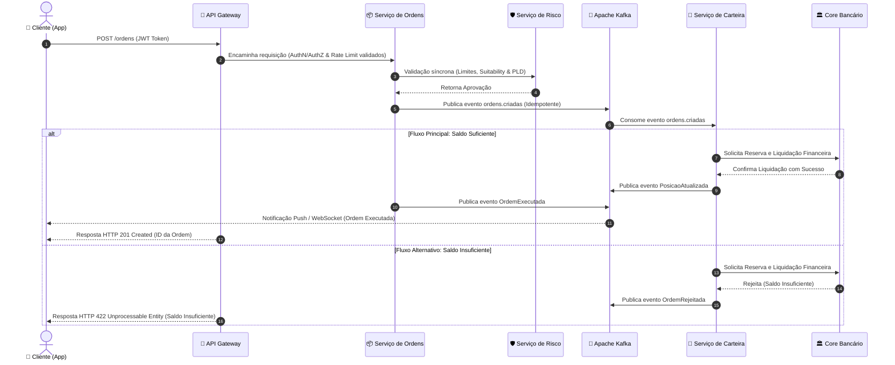
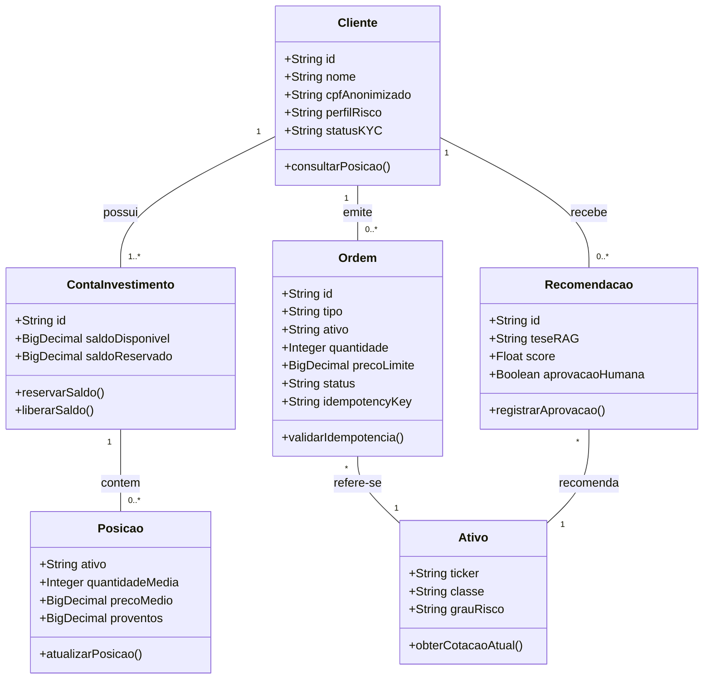
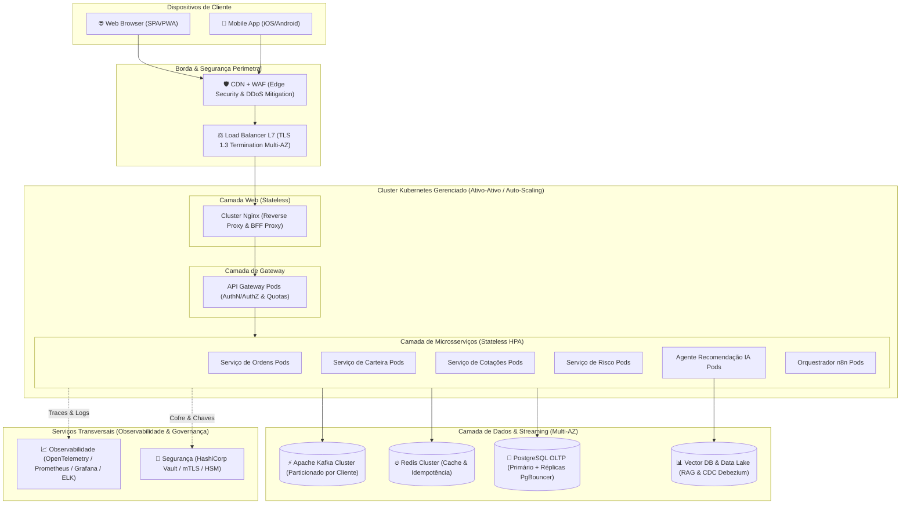

# Diagramas Formais em Notação Mermaid — Etapa 2 da POC (Bank OnlineX)

Abaixo estão os **5 diagramas formais em notação Mermaid** correspondentes à **Etapa 2 do cronograma da POC**. Todos foram estruturados rigorosamente com base nas especificações técnicas e nos registros de decisão arquitetural (ADRs-001 a 005) do Bank OnlineX.

---

### 1. Diagrama de Casos de Uso
Mapeia os cinco atores do sistema e suas interações com as funcionalidades da plataforma de investimentos. Destaca o ponto de validação humana obrigatória (*human-in-the-loop*) para as ações geradas pelos Agentes de IA.

---

### 2. Diagrama de Componentes
Organizado nas camadas de **Apresentação**, **Serviços (Microsserviços em Kubernetes)** e **Dados/Integração**. Ilustra a comunicação síncrona via API Gateway/BFF, assíncrona via Apache Kafka e a governança de acesso à IA intermediada por servidores **MCP (Model Context Protocol)** (ADR-005).

---

### 3. Diagrama de Sequência — Execução de Ordem de Investimento
Detalha os 12 passos do fluxo transacional síncrono/assíncrono da emissão de ordem até a liquidação. Inclui o tratamento do **fluxo alternativo de saldo insuficiente**, que resulta em evento `OrdemRejeitada` e retorno HTTP 422 sem gerar estados intermediários parciais.

---

### 4. Diagrama de Classes (Modelo de Domínio DDD)
Apresenta os agregados e entidades do domínio sob os princípios de *Domain-Driven Design*. Mapeia os atributos principais, comportamentos e cardinalidades entre `Cliente`, `ContaInvestimento`, `Ordem`, `Ativo`, `Posicao` e `Recomendacao`.

---

### 5. Diagrama de Implantação (Topologia Multi-AZ TO-BE)
Representa a infraestrutura distribuída para atender a **10.000 TPS sustentados (picos de 25.000 TPS)**. Mapeia a borda perimetral com CDN/WAF e Load Balancer L7, a camada de aplicação stateless em Kubernetes (HPA), o backbone de mensageria Apache Kafka, o cache Redis Cluster, a persistência no PostgreSQL OLTP e as plataformas transversais de observabilidade e segurança Zero Trust.

