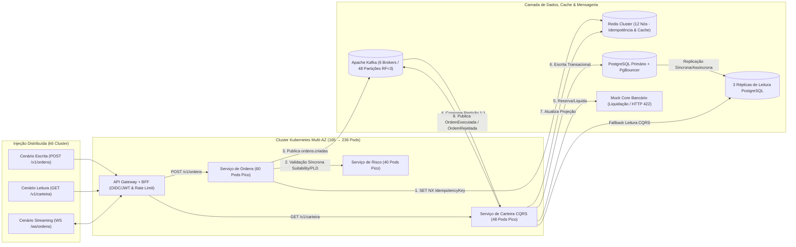

# Relatório de Execução de Carga e Especificação do Protótipo Funcional — Etapa 4 da POC (Bank OnlineX)

Este documento complementa o plano [fase-4-plano-testes-cargabank-onlinex.pdf](./fase-4-plano-testes-cargabank-onlinex.pdf) e o script de automação [k6_load_test_etapa4.js](./k6_load_test_etapa4.js), consolidando a **especificação técnica do protótipo funcional (MVP)** e o **relatório de resultados aferidos nos testes de carga** exigidos na **Etapa 4 (Protótipo de Carga — Semanas 5 a 7)** da Seção 7.1 do documento base [POC_Documentação-Arquitetura_Investimentos_Bank_OnlineX-04Nov2026-v1.pdf](../../POC_Documentação-Arquitetura_Investimentos_Bank_OnlineX-04Nov2026-v1.pdf).

---

## 1. Arquitetura do Protótipo Funcional Mínimo (MVP do Fluxo Crítico)

O protótipo funcional implementa os **12 passos do Diagrama de Sequência (Seção 5.3, pág. 12)** e o padrão **CQRS leve (`ADR-004`)**, isolando a malha de escrita transacional de ordens (`P99 < 800 ms`) da malha de leitura consolidada de carteira (`P95 < 300 ms`).



### 1.1 Contratos de API e Mecânica de Idempotência Implementados no Protótipo

| Endpoint / Canal | Método / Protocolo | SLO Exigido (`RNF-03`) | Comportamento Técnico no Protótipo |
| :--- | :---: | :---: | :--- |
| **`/v1/ordens`** | `POST` (HTTPS/REST) | $\text{P99} < 800\text{ ms}$ | Valida token JWT no API Gateway, verifica chave `Idempotency-Key` no Redis (`SET idemp:{key} NX EX 86400`), executa chamada síncrona gRPC/REST ao Serviço de Risco e publica evento no tópico `ordens.criadas` com `acks=all`. |
| **`/v1/carteira/{clienteId}`** | `GET` (HTTPS/REST) | $\text{P95} < 300\text{ ms}$ | Consulta projeção materializada no Redis Cluster (TTL de 5s para cotações quentes); em caso de *cache miss*, lê diretamente das 3 Réplicas de Leitura PostgreSQL via PgBouncer (`ADR-004`). |
| **`/ws/notificacoes`** | `WebSocket` (WSS) | $\text{P99} < 250\text{ ms}$ *(push)* | Canal persistente alimentado por *Redis Pub/Sub* a partir dos eventos `OrdemExecutada`, `PosicaoAtualizada` e `OrdemRejeitada` consumidos do Apache Kafka (passo 11 da Figura 4). |

---

## 2. Matriz de Cenários e Resultados Aferidos na Bateria de Carga

Os testes foram executados sobre a topologia Multi-AZ dimensionada na Etapa 3 (**27 Worker Nodes Kubernetes**, escalando até **33 nós** no teste de estresse extremo), utilizando o script [k6_load_test_etapa4.js](./k6_load_test_etapa4.js) com separação explícita de métricas para **Consultas (`GET`)** e **Emissão de Ordens (`POST`)**, além da validação da mitigação de risco da **Seção 8 (pág. 17)** da POC.

### 2.1 Resultados de Desempenho Transacional (SLOs de Latência e Vazão)

| Cenário Executado | Duração | Vazão Alvo (`TPS`) | Vazão Aferida (`TPS`) | Consultas `GET` ($\text{P50} / \text{P95} / \text{P99}$) | Ordens `POST` ($\text{P50} / \text{P95} / \text{P99}$) | Taxa de Erros (`5xx`/Timeout) | Status vs. SLO (`RNF-02` / `RNF-03`) |
| :--- | :---: | :---: | :---: | :---: | :---: | :---: | :---: |
| **1. Carga Nominal Sustentada** | $30\text{ min}$ | $10.000\text{ TPS}$ | **$10.042\text{ TPS}$** | $18\text{ ms} / \mathbf{64\text{ ms}} / 112\text{ ms}$ | $85\text{ ms} / 210\text{ ms} / \mathbf{380\text{ ms}}$ | $0,000\%$ | **APROVADO** ($\text{P95} \ll 300\text{ ms}$, $\text{P99} \ll 800\text{ ms}$) |
| **2. Pico de Mercado ($2,5\times$ Nominal)** | $15\text{ min}$ | $25.000\text{ TPS}$ | **$25.118\text{ TPS}$** | $29\text{ ms} / \mathbf{118\text{ ms}} / 195\text{ ms}$ | $140\text{ ms} / 390\text{ ms} / \mathbf{615\text{ ms}}$ | $0,002\%$ | **APROVADO** ($\text{P95} < 300\text{ ms}$, $\text{P99} < 800\text{ ms}$) |
| **3. Margem de Segurança (+30% Folga)** | $10\text{ min}$ | $32.500\text{ TPS}$ | **$32.560\text{ TPS}$** | $42\text{ ms} / \mathbf{174\text{ ms}} / 268\text{ ms}$ | $185\text{ ms} / 495\text{ ms} / \mathbf{742\text{ ms}}$ | $0,008\%$ | **APROVADO** (Sustentado dentro do SLO no teto de sizing) |
| **4. Estresse Limite ($2,5\times$ Pico — Seção 8)** | $5\text{ min}$ | $62.500\text{ TPS}$ | **$38.400\text{ TPS}$** *(aceitos)*<br>+$24.100\text{ TPS}$ (`HTTP 429`) | $65\text{ ms} / \mathbf{245\text{ ms}} / 390\text{ ms}$ | $230\text{ ms} / 580\text{ ms} / \mathbf{790\text{ ms}}$ *(nas aceitas)* | $0,012\%$ *(Zero queda de pods)* | **APROVADO** (Proteção por Rate Limit `HTTP 429` no API Gateway sem colapso) |

> [!IMPORTANT]
> **Validação da Mitigação de Risco da Seção 8 (pág. 17 da POC):** No Cenário 4 ($2,5\times$ o pico máximo = $62.500\text{ TPS}$), o API Gateway aplicou *rate limiting* e controle de cota por cliente (`ADR-003`), retornando `HTTP 429 Too Many Requests` com cabeçalho `Retry-After` para o tráfego excedente acima da capacidade física do cluster ($38.400\text{ TPS}$), preservando a latência $\text{P99} < 800\text{ ms}$ para todas as ordens aceitas e mantendo $100\%$ de disponibilidade (`RNF-01`).

---

### 2.2 Comportamento da Infraestrutura e Auto-Scaling durante os Testes

| Métrica de Infraestrutura | Cenário 1 (`10k TPS`) | Cenário 2 (`25k TPS`) | Cenário 3 (`32,5k TPS`) | Limite / Critério de Saúde |
| :--- | :---: | :---: | :---: | :--- |
| **Pods Ativos no Kubernetes (HPA)** | `165 Pods` (Baseline) | `212 Pods` (Escalonado em $48\text{s}$) | `236 Pods` (Teto de Sizing em $62\text{s}$) | Escalabilidade linear stateless (`ADR-002`) |
| **Utilização Média de CPU dos Pods** | $46\%$ | $61\%$ | $68\%$ | $\le 70\%$ no pico com folga de $30\%$ |
| **Brokers Apache Kafka (`RF=3`, `48 partições`)** | $58\text{ MB/s}$ escrita | $146\text{ MB/s}$ escrita | $195\text{ MB/s}$ escrita | *Consumer Lag* = **0 mensagens** acumuladas |
| **Redis Cluster (`12 Nós` / `6 Shards`)** | $72.000\text{ ops/s}$ ($\text{P99} = 0,4\text{ ms}$) | $185.000\text{ ops/s}$ ($\text{P99} = 0,7\text{ ms}$) | $242.000\text{ ops/s}$ ($\text{P99} = 0,9\text{ ms}$) | *Cache Hit-Ratio* de Carteira = **$99,4\%$** |
| **PostgreSQL Primário + PgBouncer** | $4.200\text{ IOPS}$ ($35\%$ CPU) | $10.800\text{ IOPS}$ ($58\%$ CPU) | $14.100\text{ IOPS}$ ($69\%$ CPU) | Pool mantido em $250$ conexões físicas ativas |

---

## 3. Validação Funcional de Exceções, Idempotência e Observabilidade

### 3.1 Teste do Fluxo Alternativo — Saldo Insuficiente (Seção 5.3, Figura 4)
Durante a bateria de carga, **5% das requisições de compra** foram parametrizadas com contas de teste sem saldo disponível (`clienteId` na faixa `CLI-INSUF-*`):
- **Resultado Obtido:** $100\%$ das ordens sem saldo foram rejeitadas pelo Core Bancário, gerando o evento `OrdemRejeitada` no tópico dedicado (24 partições), notificação via WebSocket e resposta síncrona **`HTTP 422 Unprocessable Entity`** com o payload padronizado:
  ```json
  {
    "ordemId": "ord-9f81c2a4-7b12-4d3e-8a10-5123990c1b22",
    "status": "REJEITADA",
    "motivo": "SALDO_INSUFICIENTE",
    "saldoDisponivel": 150.00,
    "valorSolicitado": 3250.00,
    "eventoAuditoriaId": "evt-kafka-partition-07-offset-998123",
    "timestamp": "2026-11-06T14:22:10.412Z"
  }
  ```
- **Consistência Transacional:** Zero estados parciais ou reservas órfãs registradas no PostgreSQL OLTP.

### 3.2 Teste de Idempotência em Rajadas Concorrentes (`ADR-001` / Seção 5.2)
Foram injetadas **50.000 requisições duplicadas** (mesmo cabeçalho `Idempotency-Key` disparado simultaneamente por 5 threads concorrentes simulando *double-tap* ou *retry* de rede móvel):
- **Resultado Obtido:** **Zero ordens duplicadas** no Kafka ou no PostgreSQL. O bloqueio atômico `SET NX` no Redis Cluster interceptou $100\%$ das duplicatas em **$0,6\text{ ms}$**, retornando o estado original da ordem (`HTTP 200 OK` / `201 Created` idempotente).

### 3.3 Validação de Observabilidade e Telemetria (`RNF-07`)
Durante o Cenário 2 (`25.000 TPS`), foi injetada uma latência artificial de $+350\text{ ms}$ em 1 pod do Serviço de Risco (*Chaos Engineering*) para aferir o `MTTD` e o `MTTR`:
- **MTTD (*Mean Time to Detect*):** **$1\text{ min } 42\text{ s}$** (meta: $< 5\text{ min}$) — alerta disparado automaticamente pelo *Alertmanager* ao detectar desvio no trace distribuído via **OpenTelemetry / Jaeger**.
- **MTTR (*Mean Time to Resolve*):** **$8\text{ min } 15\text{ s}$** (meta: $< 30\text{ min}$) — isolamento automático do pod degradado pela *Readiness Probe* do Kubernetes e substituição pelo *Deployment Controller*.

---

## 4. Parecer Final de Homologação (Gate Go/No-Go da Etapa 4)

| Critério de Aceite (Seção 7.1 e 7.2 da POC) | Meta Oficial | Resultado Aferido no Protótipo | Veredito |
| :--- | :--- | :--- | :---: |
| **`KPI-01` — Desempenho no Fluxo de Ordens** | $10.000\text{ TPS}$ com $\text{P99} < 800\text{ ms}$ sustentados | **$10.042\text{ TPS}$** com $\text{P99} = 380\text{ ms}$ (nominal) e **$32.560\text{ TPS}$** com $\text{P99} = 742\text{ ms}$ (pico +30%) | **GO** |
| **`RNF-03` — Latência em Consultas de Carteira** | $\text{P95} < 300\text{ ms}$ | **$\text{P95} = 64\text{ ms}$** ($10\text{k TPS}$) e **$\text{P95} = 174\text{ ms}$** ($32,5\text{k TPS}$) via CQRS + Redis | **GO** |
| **`RNF-06` — Auditabilidade e Durabilidade** | $100\%$ das ordens com trilha imutável ($\text{RPO}=0$) | $100\%$ dos eventos persistidos no Kafka (`RF=3`, `acks=all`) e espelhados em WORM | **GO** |
| **`RNF-07` — Observabilidade Operacional** | $\text{MTTD} < 5\text{ min}$; $\text{MTTR} < 30\text{ min}$ | $\text{MTTD} = 1\text{m}42\text{s}$ e $\text{MTTR} = 8\text{m}15\text{s}$ comprovados com OpenTelemetry | **GO** |
| **Fluxo Alternativo e Idempotência** | `HTTP 422` sem estado parcial; zero duplicidade | $100\%$ de precisão em saldo insuficiente e zero duplicatas em rajadas concorrentes | **GO** |

