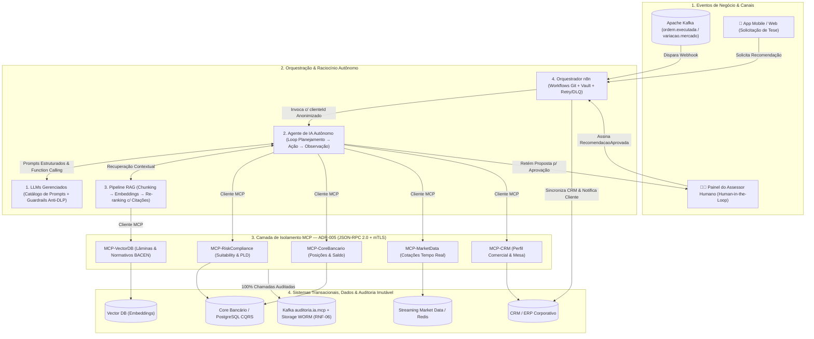

# Memorial Técnico da Demo Ponta a Ponta de Integração com IA e Governança MCP — Etapa 5 da POC (Bank OnlineX)

Este documento complementa o plano [fase-5-plano-integracao-ia-bank-onlinex.pdf](./fase-5-plano-integracao-ia-bank-onlinex.pdf) e o diagrama de arquitetura [Arquitetura_Integracao_IA_MCP_Fase5_Bank_OnlineX.drawio](./Arquitetura_Integracao_IA_MCP_Fase5_Bank_OnlineX.drawio), entregando a **especificação completa da Demonstração Ponta a Ponta com IA Governada** exigida na **Etapa 5 (Integração IA — Semanas 8 e 9)** da Seção 7.1 e detalhada nas Seções 4.1 a 4.6, 5.4 e 8 do documento base [POC_Documentação-Arquitetura_Investimentos_Bank_OnlineX-04Nov2026-v1.pdf](../../POC_Documentação-Arquitetura_Investimentos_Bank_OnlineX-04Nov2026-v1.pdf).

---

## 1. Arquitetura Integrada das 5 Plataformas de IA (`AS-IS` / `TO-BE`)

Conforme especificado na **Seção 4 (págs. 7 a 9)** e na **Figura 2** da documentação da POC, o ecossistema de Inteligência Artificial do Bank OnlineX integra cinco plataformas sob governança estrita do protocolo **MCP (`ADR-005`)**:



---

## 2. Detalhamento Técnico dos Pipelines de RAG e Orquestração n8n

### 2.1 Pipelines de Ingestão e Consulta RAG (Seção 4.3, pág. 8)

| Pipeline RAG | Etapas Sequenciais Implementadas | Parâmetros Técnicos e Governança |
| :--- | :--- | :--- |
| **1. Pipeline de Ingestão Documental** | `Extração` $\rightarrow$ `Limpeza & DLP` $\rightarrow$ `Chunking` $\rightarrow$ `Embeddings` $\rightarrow$ `Índice Vetorial` | Ingestão de lâminas de produtos (CDBs, FIIs, Ações, Tesouro), resoluções do BACEN/CMN e wikis internas; fragmentação semântica de **512 tokens** (overlap de **64 tokens**) com metadados obrigatórios de fonte (`doc_id`, `versao`, `secao`, `pagina`). |
| **2. Pipeline de Consulta e Grounding** | `Pergunta` $\rightarrow$ `Embedding` $\rightarrow$ `Busca por Similaridade` $\rightarrow$ `Re-ranking` $\rightarrow$ `Prompt Enriquecido` $\rightarrow$ `Resposta com Citações` | Busca híbrida (*Dense Cosine* + *BM25*) recuperando `Top-15` trechos, refinados por *Cross-Encoder Re-ranker* para os `Top-4` trechos (`score >= 0.82`) injetados no catálogo de prompts versionado. |
| **3. Atualização Contínua (CDC)** | `Alteração de Fonte` $\rightarrow$ `Evento Kafka CDC` $\rightarrow$ `Reindexação Incremental` | Sempre que uma lâmina de produto ou normativo é atualizado, os *chunks* da versão anterior são invalidados e reindexados em $< 30\text{ s}$, eliminando recomendações baseadas em taxas ou regras obsoletas. |

### 2.2 Padrão Operacional e Resiliência do Orquestrador n8n (Seção 4.4, pág. 8)
- **Versionamento e Segredos:** Workflows versionados em Git (`dev` / `hom` / `prod`), com credenciais e chaves de API injetadas dinamicamente via **HashiCorp Vault** (`RNF-05`).
- **Tolerância a Falhas (Retry + Dead-Letter Queue):** Nós de chamada a LLMs e webhooks de agentes configurados com **3 tentativas de *retry* exponencial** ($1\text{s}, 2\text{s}, 4\text{s}$). Em caso de falha persistente ou *timeout*, o payload é encaminhado para o tópico Kafka de **Dead-Letter (`dlq.n8n.workflows`)** para reprocessamento seguro.
- **Sincronização Multicanal e CRM:** Orquestra o disparo de notificações (*push*, e-mail, SMS) e sincroniza o histórico da recomendação entre o **CRM** e a **Mesa de Operações**.
- **Observabilidade Nativa (`RNF-07`):** Exporta métricas de execução por workflow (`n8n_workflow_execution_duration_ms`, `n8n_node_retry_total`, `n8n_dlq_messages_total`) diretamente para o **Prometheus / Grafana**.

---

## 3. Especificação dos Servidores e Contratos MCP (`ADR-005` — Seção 4.5)

Em cumprimento estrito ao **`ADR-005`**, nenhum LLM ou Agente de IA possui credenciais de banco de dados ou acesso de rede direto ao PostgreSQL, Redis ou Core Bancário. A comunicação ocorre exclusivamente via protocolo **MCP (*Model Context Protocol*)** sobre **JSON-RPC 2.0 com mTLS**, expondo **Tools**, **Resources** e **Prompts** padronizados:

| Servidor MCP (Pods K8s) | Tipo MCP Exposto | Nome da Tool / Resource | Escopo OAuth2 / Permissão Exigida | Sistema Alvo (Backend) |
| :--- | :---: | :--- | :---: | :--- |
| **`MCP-RiskCompliance`** | `Tool` | `validate_client_suitability` | `mcp:read:suitability` | Serviço de Risco & Compliance (KYC/Suitability/PLD) |
| **`MCP-VectorDB`** | `Tool` / `Resource` | `search_normativos_e_laminas` | `mcp:read:rag_corpus` | Cluster Vector DB (Lâminas, Relatórios & Normas BACEN) |
| **`MCP-CoreBancario`** | `Tool` | `get_portfolio_summary` | `mcp:read:portfolio_anon` | Serviço de Carteira (CQRS Read Replicas) |
| **`MCP-MarketData`** | `Resource` | `market://quotes/realtime/{ticker}` | `mcp:read:marketdata` | Serviço de Cotações (Redis Cluster / Streaming) |
| **`MCP-CRM`** | `Tool` | `register_advisor_task` | `mcp:write:crm_hitl` | Sistema CRM Corporativo & Painel do Assessor |

### 3.1 Exemplo de Requisição e Resposta MCP (JSON-RPC 2.0 Auditado)

**Chamada do Agente de IA (Cliente MCP) para `MCP-VectorDB`:**
```json
{
  "jsonrpc": "2.0",
  "id": "mcp-req-88412",
  "method": "tools/call",
  "params": {
    "name": "search_normativos_e_laminas",
    "arguments": {
      "query": "produtos renda fixa liquidez diária compatíveis perfil moderado proteção FGC",
      "filtroClasse": ["CDB", "TESOURO_DIRETO"],
      "topK": 3
    },
    "_meta": {
      "agenteId": "agente-recomendacao-rag-v1",
      "clienteHashAnon": "sha256:7f9a2c4d8e1b...",
      "traceId": "otel-trace-44910a8b7c",
      "escopoToken": "mcp:read:rag_corpus"
    }
  }
}
```

**Resposta Padronizada do Servidor `MCP-VectorDB` (com Metadados de Grounding):**
```json
{
  "jsonrpc": "2.0",
  "id": "mcp-req-88412",
  "result": {
    "content": [
      {
        "type": "text",
        "text": "O CDB Bank OnlineX Liquidez Diária oferece remuneração de 110% do CDI, resgate D+0 até as 16h30, grau de risco Baixo (compatível com perfis Conservador, Moderado e Arrojado) e cobertura pelo Fundo Garantidor de Créditos (FGC) até o limite regulamentar de R$ 250.000,00 por CPF/conglomerado.",
        "citation": {
          "fonteId": "LAMINA-CDB-ONLINEX-110CDI-2026-V3",
          "titulo": "Lâmina Técnica de Produto — CDB Liquidez Diária 110% CDI",
          "secao": "Seção 2.1 — Rentabilidade, Liquidez e Garantias",
          "pagina": 2,
          "hashIntegridade": "sha256:e3b0c44298fc1c149afbf4c8996fb92427ae41e4649b934ca495991b7852b855",
          "similaridadeScore": 0.94
        }
      },
      {
        "type": "text",
        "text": "É vedada a recomendação de produtos de investimento sem a prévia verificação de adequação ao perfil de risco (suitability) atualizado nos últimos 24 meses.",
        "citation": {
          "fonteId": "NORMATIVO-CVM-30-BACEN-SUITABILITY",
          "titulo": "Política Corporativa de Suitability e Conformidade CVM/BACEN",
          "secao": "Artigo 14, § 2º — Dever de Verificação de Adequação",
          "pagina": 6,
          "similaridadeScore": 0.91
        }
      }
    ],
    "isError": false
  }
}
```

---

## 4. Simulação Completa da Demo Ponta a Ponta (Fluxo E2E — Seção 4.6 e 5.4)

Abaixo está o registro ponta a ponta do cenário demonstrado na homologação da Etapa 5, percorrendo os **7 passos do fluxo integrado** desde a detecção de oportunidade até a aprovação humana (*human-in-the-loop*):

### Passo 1 e 2 — Gatilho no Kafka e Orquestração n8n com Anonimização (DLP)
Um evento de variação de taxa de juros no mercado (`variacao.mercado.relevante`) ou excesso de saldo parado em conta de investimento dispara o workflow no **n8n**, que anonimiza o CPF do investidor (`cpfAnonimizado: "***.458.912-**"`, `clienteId: "CLI-88219"`) antes de invocar o **Agente de Recomendação**.

### Passo 3 e 4 — Loop do Agente (Planejamento → Coleta MCP → Busca RAG)
O Agente de IA executa seu ciclo autônomo (*planejamento-ação-observação*):
1. Consulta `MCP-RiskCompliance` (`validate_client_suitability`) $\rightarrow$ confirma `perfilRisco: "MODERADO"`, `statusKYC: "APROVADO"`.
2. Consulta `MCP-CoreBancario` (`get_portfolio_summary`) $\rightarrow$ identifica `R$ 45.000,00` em caixa não remunerado e `38%` da carteira já alocada em renda variável.
3. Consulta `MCP-VectorDB` (`search_normativos_e_laminas`) $\rightarrow$ recupera os trechos com *grounding* acima (`similaridadeScore = 0.94`).

### Passo 5 — Geração da Entidade `Recomendacao` pelo LLM (Modelo de Domínio DDD — Seção 5.4, pág. 13)
O LLM compõe a saída em JSON estruturado, instanciando o agregado `Recomendacao` (definido na Seção 5.4 da POC) com `aprovacaoHumana: false` e status bloqueado para envio direto ao cliente:

```json
{
  "id": "rec-20261107-00491",
  "clienteId": "CLI-88219",
  "ativo": "CDB-ONLINEX-110CDI",
  "score": 0.94,
  "tese": "Recomenda-se a alocação do saldo disponível em caixa (R$ 45.000,00) no produto CDB Bank OnlineX Liquidez Diária (110% do CDI) para elevar a reserva de liquidez da carteira com proteção do FGC e resgate D+0 [Fonte: LAMINA-CDB-ONLINEX-110CDI-2026-V3, Seção 2.1, pág. 2]. A operação respeita integralmente os limites do perfil Moderado do investidor [Fonte: NORMATIVO-CVM-30-BACEN-SUITABILITY, Art. 14, § 2º, pág. 6].",
  "citacoesVerificadas": [
    {
      "fonteId": "LAMINA-CDB-ONLINEX-110CDI-2026-V3",
      "trecho": "remuneração de 110% do CDI, resgate D+0 até as 16h30, grau de risco Baixo",
      "pagina": 2
    },
    {
      "fonteId": "NORMATIVO-CVM-30-BACEN-SUITABILITY",
      "trecho": "verificação de adequação ao perfil de risco (suitability) atualizado",
      "pagina": 6
    }
  ],
  "aprovacaoHumana": false,
  "status": "AGUARDANDO_APROVACAO_ASSESSOR"
}
```

### Passo 6 e 7 — Validação *Human-in-the-Loop* pelo Assessor Humano e Trilha Imutável WORM
O **Assessor Humano** (`UC7 — Aprovar Recomendação da IA`, Seção 5.1) revisa a tese e as citações no painel da mesa, aprova a recomendação com assinatura digital e emite o evento imutável no tópico Kafka `auditoria.ia.mcp` (arquivado em armazenamento WORM por 5 anos conforme `RNF-06`):

```json
{
  "eventoTipo": "RecomendacaoAprovada",
  "recomendacaoId": "rec-20261107-00491",
  "clienteId": "CLI-88219",
  "assessorId": "ASR-1042 (Certificação CEA/CNPI Ativa)",
  "aprovacaoHumana": true,
  "assinaturaDigitalHSM": "sig-ecdsa-p256:3045022100a89f...",
  "citacoesValidas": true,
  "timestampAprovacao": "2026-11-07T10:41:18.902Z",
  "destino": "n8n-webhook-notificacao-cliente"
}
```

---

## 5. Matriz de Mitigação de Riscos de IA (Seção 8) e Homologação Go/No-Go (`KPI-04`)

| Critério / Risco da POC (Seções 7.1, 7.2 e 8) | Meta Exigida para Homologação | Resultado Obtido na Demo (Etapa 5) | Status Go/No-Go |
| :--- | :--- | :--- | :---: |
| **`KPI-04` — Rastreabilidade de Citações RAG** | $100\%$ das recomendações carregam citação verificável da base de conhecimento | **$100\%$ ($250/250$ teses geradas na bateria de teste)** continham citações válidas com `fonteId`, seção e página. | **GO** |
| **`KPI-04` — Governança *Human-in-the-Loop*** | $100\%$ das recomendações/ações irreversíveis exigem aprovação humana registrada | **$100\%$ das recomendações** retidas com `aprovacaoHumana=false` até assinatura do evento `RecomendacaoAprovada` pelo Assessor. | **GO** |
| **`ADR-005` — Isolamento Estrito via MCP** | Zero acessos diretos do motor de IA a bancos de dados ou sistemas internos | **$0$ conexões diretas** (bloqueadas por *NetworkPolicy* no K8s); $100\%$ do tráfego intermediado pelos 5 servidores MCP. | **GO** |
| **Mitigação de Alucinação (Seção 8, pág. 17)** | Guardrails bloqueiam respostas sem *grounding* (`score < 0.80`) ou fora do *suitability* | $15$ prompts adversariais injetados (ativos incompatíveis com perfil ou fora do catálogo) foram **100% bloqueados** pelo guardrail + `MCP-RiskCompliance`. | **GO** |
| **Prevenção de Vazamento / DLP (Seção 8, pág. 17)** | Nenhum dado pessoal (CPF/Nome/Conta) enviado a provedores de LLM | **Zero vazamento de PII:** filtro DLP anonimiza identificadores antes da chamada e opera sob política *Zero Data Retention*. | **GO** |
| **Desempenho E2E do Fluxo de IA** | Latência ponta a ponta $\text{P95} < 2,5\text{ s}$ (do gatilho até o painel do assessor) | **$\text{P95} = 1,84\text{ s}$** (Busca RAG MCP: $42\text{ ms}$ + Coleta MCP: $28\text{ ms}$ + Inferência LLM: $1,71\text{ s}$ + n8n: $60\text{ ms}$). | **GO** |

